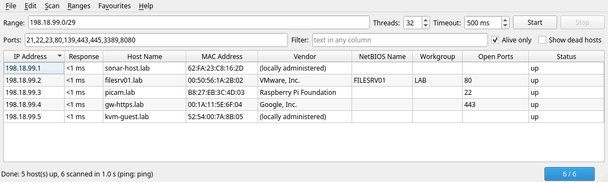

# Sonar

Multithreaded IP network scanner for **Rocky Linux 9 and 10**.

Type a range, press Start, and Sonar pings every address in parallel, then
shows each live host's response time, host name, MAC address and vendor,
NetBIOS name and open TCP ports. Right-click a host to open it in a browser,
[Skiff](https://github.com/mike0615/skiff) or
[MultiSSH Manager](https://github.com/mike0615/multissh-manager-v2). It never
needs root.



| Feature | Sonar |
|---|---|
| Ranges | `10.0.0.1-254`, `10.0.0.1-10.0.1.40`, `10.0.0.0/24`, `10.0.0.*`, comma lists |
| Discovery | Unprivileged ICMP echo, then `/usr/bin/ping`, then a TCP connect probe; no root |
| Speed | Configurable threads (1-512) and timeout, progress bar, Start / Stop |
| Host details | Reverse DNS, MAC + vendor (ARP table + hwdata OUI list), NetBIOS name and workgroup, response time |
| Port scan | Your TCP port list (`22,80,443,8000-8010`) on every live host |
| Results | Sort by any column (IPs sort numerically), filter box, Alive only toggle |
| Export | CSV, TXT, HTML, XML |
| Lists | Saved ranges and favourite hosts |
| Right-click | Copy IP / row, Ping, Open in browser (http / https), Open in Skiff, Open in MultiSSH Manager |
| Config | Master file `/etc/sonar/sonar.conf`, per-user `~/.config/sonar/sonar.conf`, Edit > Preferences |
| Help | `F1` opens Help > Sonar Help ([HELP.md](HELP.md)); Help > About Sonar |

## Install

Two dist-tagged noarch RPMs are provided. Use the one that matches your release.
Everything they need is in the stock BaseOS / AppStream repos (no EPEL).

Download the RPMs from the [latest release](https://github.com/mike0615/sonar/releases/latest), or install directly:

```
# Rocky Linux 9
sudo dnf install https://github.com/mike0615/sonar/releases/download/v1.0.0/sonar-1.0.0-1.el9.noarch.rpm
# Rocky Linux 10
sudo dnf install https://github.com/mike0615/sonar/releases/download/v1.0.0/sonar-1.0.0-1.el10.noarch.rpm
```

Then start **Sonar** from the applications menu, or run `sonar`
(`sonar --range 10.0.0.0/24` pre-fills the Range box). Verify downloads with
`SHA256SUMS` from the release. Remove with `sudo dnf remove sonar`.

| Release | Qt binding | Pulled in by dnf |
|---|---|---|
| Rocky 9 | PyQt5 | `python3-qt5-base`, `hwdata`, `iproute`, `iputils` (+ `qt5-qtsvg` recommended) |
| Rocky 10 | PyQt6 | `python3-pyqt6-base`, `hwdata`, `iproute`, `iputils` (+ `qt6-qtsvg` recommended) |

## Master configuration file

`/etc/sonar/sonar.conf` (INI, `%config(noreplace)`) holds the system
defaults. Any key can be overridden per user in `~/.config/sonar/sonar.conf`;
Edit > Preferences writes only the keys you change there.

```ini
[scan]
threads = 64
timeout_ms = 1000
ping_method = auto            ; auto | icmp | ping | tcp
probe_ports = 80,443,22,445,139,3389,8080,53,21,23
ports = 21,22,23,25,53,80,110,135,139,143,443,445,3389,5900,8080,8443
scan_ports = yes
resolve_hostnames = yes
netbios = yes
show_dead = no

[launchers]
skiff_path = /usr/bin/skiff
multissh_path = /usr/bin/multissh-manager
default_user =                ; blank = your login name
ssh_port = 22
skiff_add_site = yes
skiff_args =                  ; {host} {user} {port} are replaced
multissh_args = {session_file}
browser_command =             ; blank = desktop default; {url}
```

If a configured path isn't executable, Sonar looks the program name up on
`PATH`. If neither works, that right-click entry is greyed out.

## Opening hosts in Skiff and MultiSSH Manager

Neither program takes a host name on its command line yet, so Sonar uses what
each one does support:

- **Open in Skiff** adds a site named `Sonar: <ip>` (host, `ssh_port`,
  `default_user`, agent auth, no password) to Skiff's Site Manager file
  `~/.config/skiff/sites.json`, unless a site for that host and port already
  exists, then runs `skiff_path` plus `skiff_args`. Press `Ctrl+S` in Skiff and
  pick the site. Set `skiff_add_site = no` to only start Skiff.
- **Open in MultiSSH Manager** writes a one-host session file
  `~/.cache/sonar/multissh/sonar-<ip>.json` and runs
  `multissh-manager <that file>`. The host is in a **Sonar** folder;
  double-click it to connect. Your own `sessions.json` is not touched.

When either program gains a host option, point `skiff_args` /
`multissh_args` at it (for example `skiff_args = --host {host} --user {user}`).

## Not included

- **SNMP** queries and **SMB share** listing: both need libraries that aren't in
  the stock Rocky repos (net-snmp Python bindings / an SMB client library).
- Wake-on-LAN, remote shutdown and IPv6 scanning.
- MAC addresses are only visible for hosts on your own subnet (ARP).

Only scan networks you own or are allowed to scan.

## Build from source

Building is only needed for development.

```bash
git clone https://github.com/mike0615/sonar.git && cd sonar
./build.sh            # on Rocky 9 or 10: sudo dnf install rpm-build python3 desktop-file-utils first
./build.sh 9 10       # anywhere with podman or docker: build both in Rocky containers
python3 -m unittest discover -s tests -t .           # unit tests (loopback only)
QT_QPA_PLATFORM=offscreen python3 tests/smoke_offscreen.py
```

Output goes to `out/`. Run from the tree without installing: `./bin/sonar`.

## License

MIT, see [LICENSE](LICENSE). Copyright (c) 2026 Mike Anderson.
